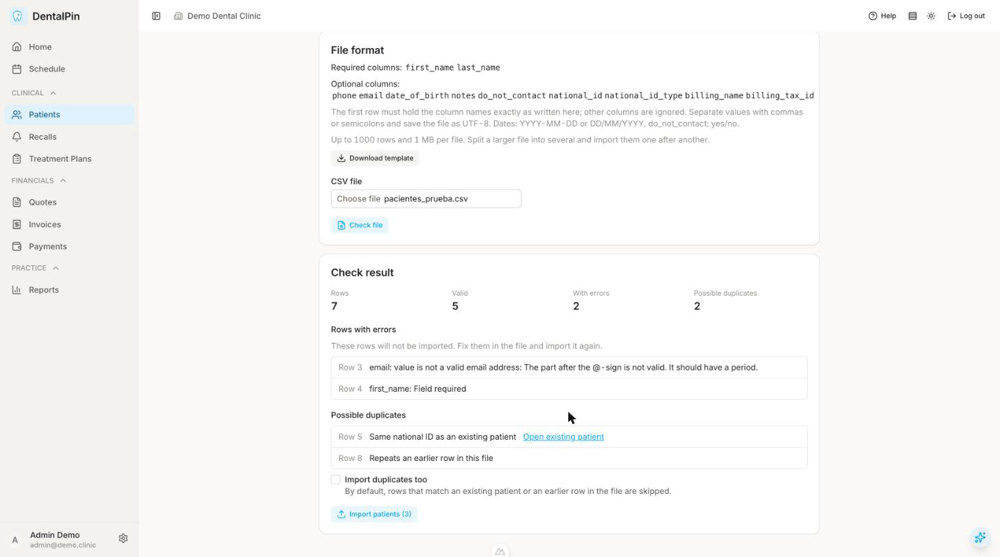

# Import patients from CSV

Adds many patients at once from a CSV file, for example an export from
your previous practice software or a spreadsheet. The file is checked
first; nothing is saved until you confirm.

Open it from the patient list with **Import CSV**. The button and the
screen need the `patients.write` permission.

## 1. Prepare the file

- The first row holds the column names. **Required:** `first_name`,
  `last_name`. **Optional:** `phone`, `email`, `date_of_birth`,
  `notes`, `do_not_contact`, `national_id`, `national_id_type`,
  `billing_name`, `billing_tax_id`. Other columns are ignored, so an
  export from another system can be imported without deleting columns,
  but the names above must match exactly.
- **Download template** gives you a file with the right header and one
  example row.
- Values separated by commas or semicolons (detected automatically).
  Save the file as UTF-8.
- Dates as `YYYY-MM-DD` or `DD/MM/YYYY`. `do_not_contact` takes
  yes/no, true/false or 1/0; empty means no.
- At most 1000 rows and 1 MB per file. Split a larger list into several
  files and import them one after another.

## 2. Check the file

Choose the file and click **Check file**. This runs the import without
saving anything and shows:

- **Rows**, **Valid**, **With errors** and **Possible duplicates**.
- **Rows with errors**: the file line and the reason (a missing name, an
  invalid email, a date in another format…). These rows are never
  imported; fix them in the file and import it again.
- **Possible duplicates**: rows that match an existing patient by
  national ID, or by email and date of birth together, with a link to
  that patient. A row that repeats an earlier row of the same file is
  listed too.

A file that cannot be read at all (not UTF-8, missing a required
column, over the limits) shows the reason instead of a result.

## 3. Import

Click **Import patients (N)**. N is the number of valid rows, minus the
possible duplicates. Tick **Import duplicates too** to create those
rows as well.

Each patient is created exactly as if it had been entered by hand, so
other modules react as usual. A large file can take a little while.
When it finishes, the screen shows how many patients were created and
how many were skipped as duplicates.

If the import fails part-way, look at the patient list before trying
again: some patients may already have been created, and the duplicate
check only recognises rows with a national ID or with an email and a
date of birth.
